# Site Creator

A small local app for building static websites from reusable **blocks**.
You edit in the browser with a live preview and drag and drop, then export a plain
HTML/CSS/JS folder (ZIP) that you can upload to any hosting.

This repository only holds the description and screenshots. The app itself lives in a separate, private repository.

## What it does

- **Blocks.** Every page is a stack of blocks (header, hero, price list, timetable, columns, footer and more). Reorder them by dragging, duplicate or hide them, and edit each one in a form.
- **31 starters in folders.** Bakery, restaurant, coffee roaster, electrician, yoga studio, law office, wedding page, developer CV, digital garden and more. All the names, prices and contact details in them are made up.
- **Guided setup for every starter.** Pick a starter and a short dialog opens, already set to that starter's own look. Change the palette, fonts, shapes, header, footer and gradients with a live preview, or skip it and keep the starter as it is.
- **Site and design.** 39 colour palettes, font pairings, corner roundness, button shapes, content width, dark mode, and gradients with direction, opacity, size and optional slow animation.
- **Move elements.** Drag any element in the preview. Desktop and phone layouts are saved separately.
- **Undo and redo**, automatic saving, and a one-click **Export ZIP**.
- **Your own blocks.** Build a custom block from fields, an HTML template, CSS and optional JS.
- **Help assistant.** A local chat that answers "how do I..." questions (runs through Ollama).

## Screenshots

### Pick a starter
Starters are sorted into folders.

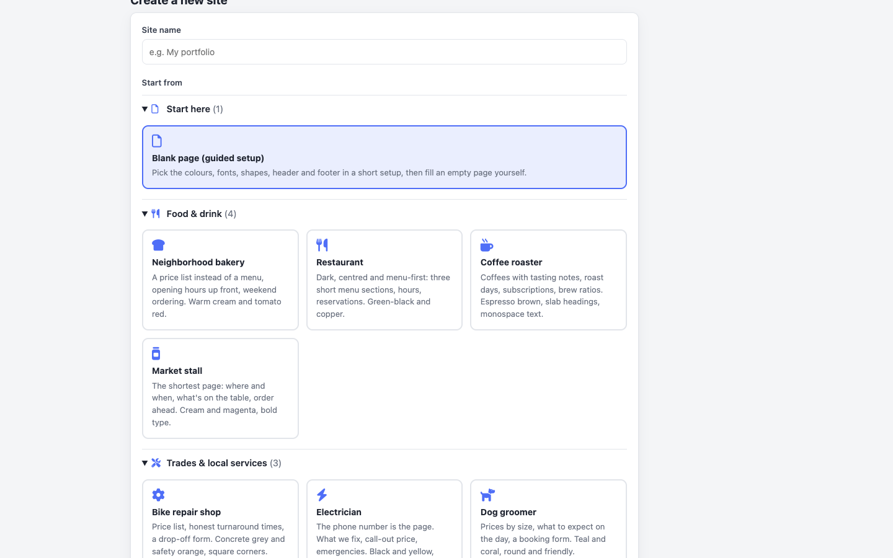

### Guided setup
The dialog opens on the starter's own palette, with a preview of its real page.

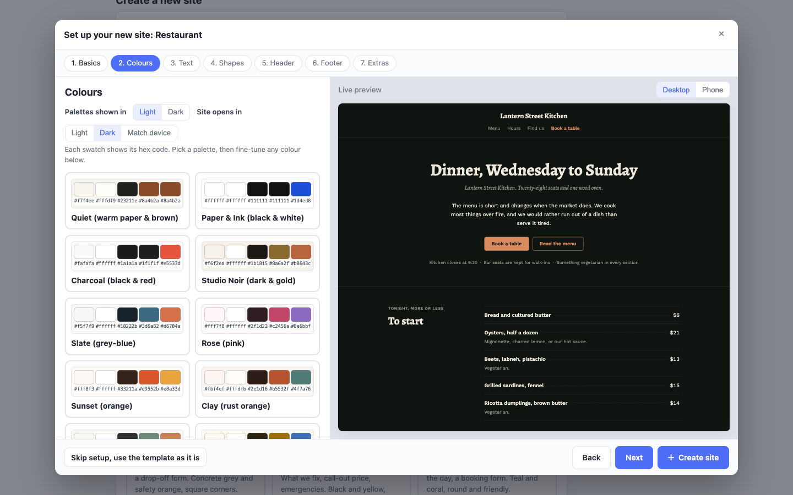

Header and footer can be switched to another style or left as the starter has them.

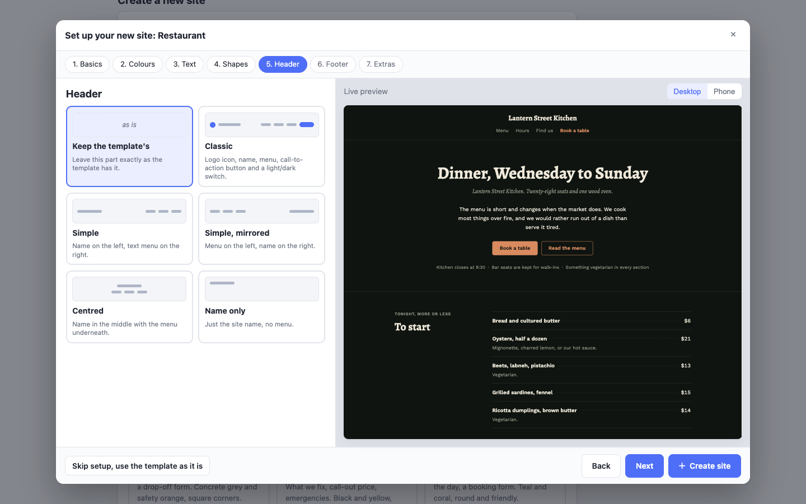

Optional gradients for the header, footer, buttons and section backgrounds.

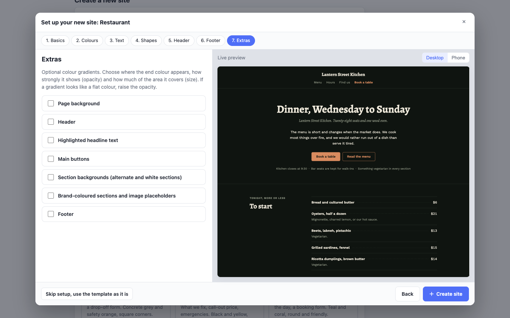

### Editor
Blocks on the left, the selected block's fields in the middle, the page on the right.

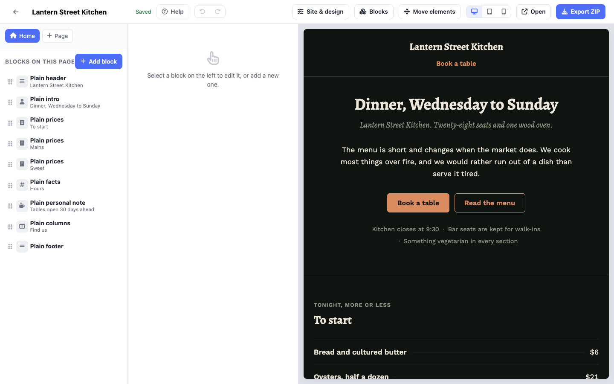

### Blocks
Built-in and custom blocks. Any block can be a starting point for your own.

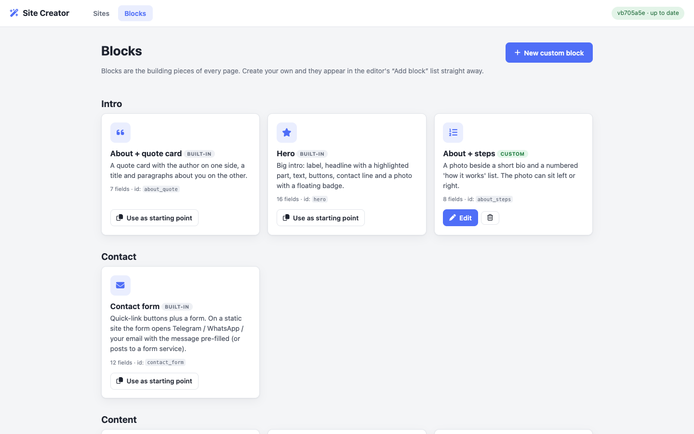

### Some of the starters, as exported

| | |
|---|---|
| 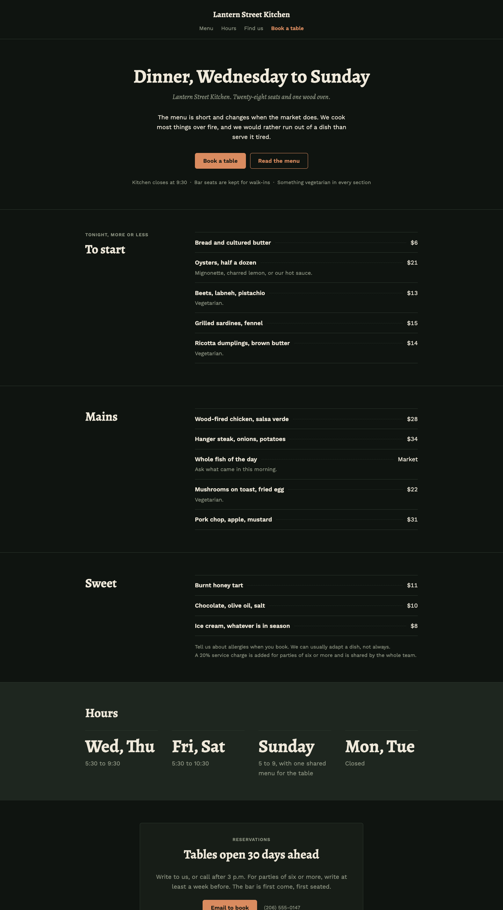 | 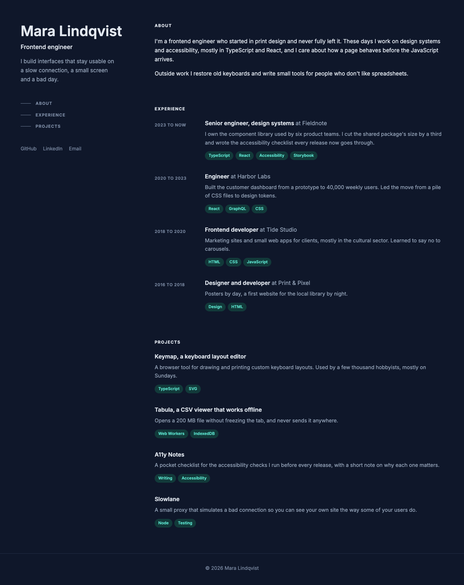 |
| Restaurant | Developer CV |
| 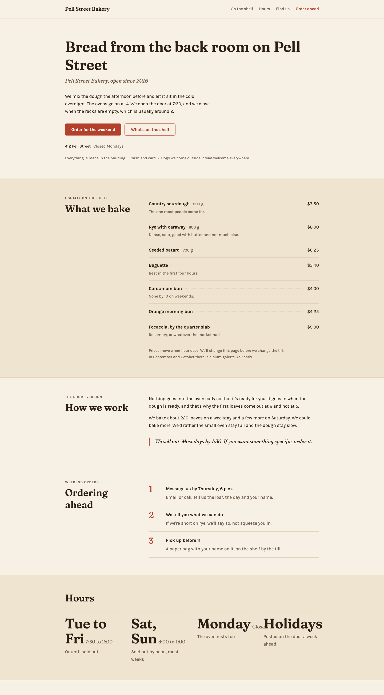 | 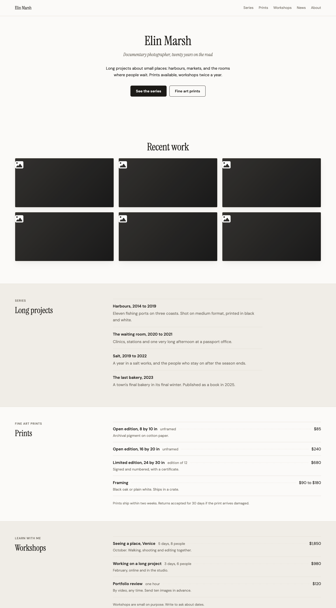 |
| Neighborhood bakery | Photographer with prints and workshops |
| 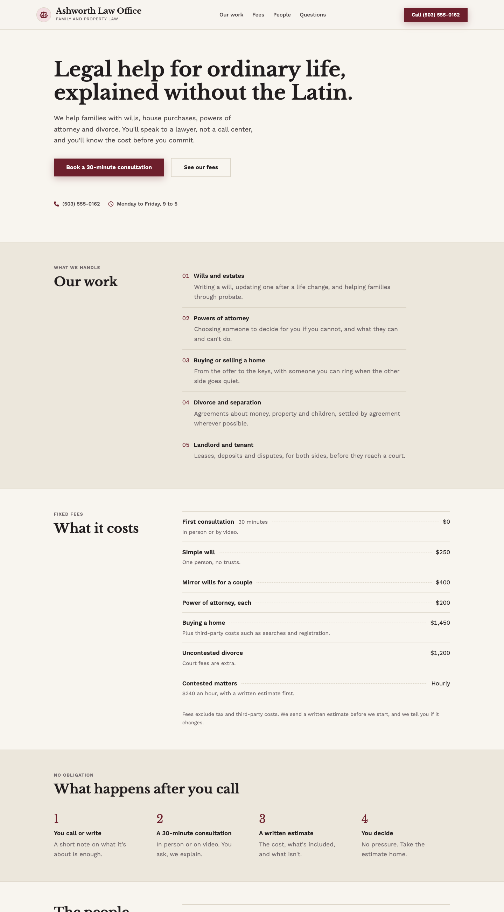 | |
| Law office | |

## Built with

Python and Flask, with plain HTML, CSS and JavaScript in the browser. Exported sites need no build step and no server.

## Author

Made by n1ji.
